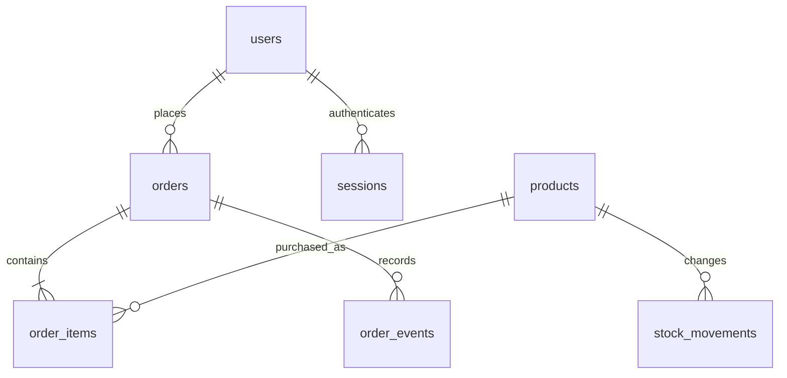

# Sako Supply

A full-stack, single-store rice wholesale research prototype: responsive HTML/CSS/JavaScript frontend, Node.js backend, and a persistent SQLite SQL database. Every active product is a **25 kg sack**. Customers can buy multiple sacks; no minimum count is imposed.

## Open on a Windows laptop

1. Install **Node.js 24 LTS** from https://nodejs.org.
2. Download this repository using **Code → Download ZIP** and extract it.
3. Open the extracted folder containing `package.json`.
4. Click the File Explorer address bar, type `cmd`, and press Enter.
5. Run these commands, one at a time:

```sh
npm install
npm start
```

6. Keep the command window open and visit **http://localhost:3000** in Chrome or Edge.

To stop the server, press Ctrl+C in that command window. To start again, run `npm start`. If port 3000 is busy, stop the older server first or run `set PORT=3001` in Windows Command Prompt before `npm start` and browse to port 3001.

**Updating a previous download:** stop the old server and back up the existing `data` folder. Extract the new ZIP to a separate folder, copy your `data` folder into it, then run `npm install` and `npm start`. Do not overwrite an existing database with an empty one. Old 5 kg listings are archived, while existing orders are preserved.

## Customer capabilities

- Register, sign in, sign out, and update name, phone, and default address.
- Browse/search/filter/sort 25 kg rice products and read product details, texture, and cooking notes.
- Add multiple sacks, set quantities, choose pickup or delivery, and place an order.
- View only your own order history, status timeline, receipts, and simulated delivery route.
- Print a receipt or choose **Save as PDF** from the browser print window.

Use fictional contact information for the defense. Customer passwords are salted and hashed with scrypt. Customer and admin sessions are stored in the database, expire after 24 hours, and are revoked on logout.

## Admin dashboard

Click the regular **Sign in** button. Admin and customer accounts use the same email/password form. Demo admin email: **`admin@sakosupply.com`**; password: **`admin123`**. Successful admin sign-in opens the dashboard and reveals its navigation link. Customer accounts never see admin controls. `ADMIN_EMAIL` and `ADMIN_PASSWORD` can override these demo defaults. `/admin` remains an optional shortcut to the same sign-in form; it is no longer necessary. Use an incognito window or another browser for simultaneous customer/admin demonstrations.

- **Overview:** pending orders, low stock (10 or fewer sacks), available sacks, recent active orders, and today's completed order totals.
- **Orders:** search by reference/name/phone, filter status, view details, print receipts, record cash collection, and progress orders.
- **Products & inventory:** create/edit/archive products, upload product photos, and record positive or negative stock adjustments with reasons. New products start at zero stock. Use **Change image** in the inventory table to preview, replace, or remove a photo. You can also upload a photo while creating a product. Only supplier-authorized PNG/JPEG/WebP images under 2 MB are accepted.
- **Customers:** search registered customers and view their order histories.
- **Reports:** date-filtered completed sales, rice revenue excluding delivery, best sellers, and downloadable CSV.

Order flow:

- Delivery: Pending → Preparing → Out for delivery → Completed.
- Pickup: Pending → Preparing → Ready for pickup → Completed.
- Active orders can be cancelled. Stock is restored exactly once.

Payment and order status are independent. Reports use order-placement dates in Philippine time and currently completed orders. They include demo electronic payments and can include unpaid completed cash orders; they are not collected-cash, tax, or profit reports.

## Payment simulations — no real money

Cash, card, GCash, and Maya appear at checkout. **All electronic payments are simulations.** No merchant accounts, payment gateways, wallet credentials, or real card processing are connected.

Card fields are present for demonstration only. Use:

| Test                  | Card number           | Future expiry | Test CVC |
| --------------------- | --------------------- | ------------- | -------- |
| Successful simulation | `4242 4242 4242 4242` | `12/30`       | `123`    |
| Declined simulation   | `4000 0000 0000 0002` | `12/30`       | `123`    |

Never enter a real card. Card number, expiry, and CVC remain in browser-only fields and are not included in API requests or stored in the database. The backend rejects known raw-card fields. GCash and Maya show a selectable successful/declined demo outcome; no QR transfer or wallet login is requested.

Failed demo payments create no order and reserve no stock. Successful simulations show **Demo paid**; cancellation changes that to **Demo refunded**, without moving funds. Cash orders remain **Unpaid** until an admin records collection. Printed documents are clearly labeled research-demo order acknowledgments/receipts, **not tax invoices or official receipts**.

## Delivery simulation

The delivery map uses Leaflet and OpenStreetMap tiles. It shows a sample route in Koronadal, not a geocoded customer address or actual rider GPS. Checkout requires an explicit delivery/pickup choice. Delivery orders show the map near the top of order details immediately, even while Pending. Order, payment status, and timeline update automatically every five seconds; no manual refresh is needed. Pickup orders show a clear collection panel instead of a delivery map. After an admin selects **Out for delivery**, a simulated truck moves along the route over three minutes, stopping near the destination until completion. The client polls every five seconds while the details view is open. Pickup orders do not show delivery tracking.

A sample **₱150 flat delivery fee** is calculated on the server. It is not a freight quote; real wholesale delivery pricing and coverage require store confirmation.

Map tiles need Internet access to `tile.openstreetmap.org`; a bundled, clearly labeled illustrated backdrop keeps the map route visible if tiles are blocked. The illustration is not a street map or navigation aid. Fonts optionally load from `fonts.googleapis.com` and `fonts.gstatic.com`, with local fallback fonts. No map API key is required.

## Products and market descriptions

The catalog includes Dinorado, Jasmine, Sinandomeng, well-milled white rice, and brown rice—rice retail names/types familiar in the Philippine market. They are **not all cultivars or commercial brands**. The illustrations are fictional Sako packaging. Do not interpret them as supplier-certified brands, Philippine-grown origin claims, current retailer stock, or verified commercial 25 kg offerings. Sample pricing and quantities are for research only. Verify the actual supplier's specifications, origin, price, packaging, availability, and image permissions before commercial use.

## Database and architecture

No XAMPP or separate database server is required. SQLite creates `data/sako.sqlite` on first startup. It is a SQL relational database, **not MySQL**, and is not managed through phpMyAdmin. Database setup lives in [db/schema.sql](db/schema.sql); backwards-compatible migrations are in `server.js`.

Tables: `users`, `products`, `orders`, `order_items`, `sessions`, `stock_movements`, and `order_events`. Orders retain immutable product/price snapshots so catalog changes do not rewrite receipts. The old order JSON snapshot is retained solely for compatibility; the application uses normalized `order_items`.



Backend responsibilities: access control, server-calculated prices/fees, atomic stock reservation, order transitions, receipt data, and SQL persistence. Frontend responsibilities: interface, client-only test card form, print layout, and the demo map.

Back up the complete `data` directory (database plus uploaded photos) while the server is stopped. Do not delete data to reset a demonstration without preserving existing orders. `DATA_DIR` can point to another database directory; `PORT` changes the server port.

## Validation

```sh
npm test
```

Integration tests use isolated temporary databases and verify customer authentication/ownership, order pricing, stock, simulated payment success/failure, cancellation, status transitions, reports, images, migration, restart persistence, and logout.

Optional browser tests:

```sh
npx playwright install chromium
npm run test:browser
```

If you already have a Chromium installation, set `SAKO_CHROMIUM` to its executable path instead. Browser tests verify customer checkout, browser-only card fields, printable PDF layout, map movement, admin management/report export, and mobile layout. Test-only records never enter your regular database.

## Suggested defense flow

1. Explain the problem: bulk rice orders, manual stock checking, and order follow-up.
2. Show the 25 kg catalog and product details. Add five sacks.
3. Register a fictional customer; select delivery and simulate a card or wallet payment.
4. Show the order reference, payment status, and printable receipt.
5. In a second/incognito browser, click **Sign in** and use the demo admin email/password, prepare the order, then dispatch it.
6. Keep the customer's order details open; the status and moving **simulated** map update automatically.
7. Complete the order and show its report entry; export a CSV.
8. Create a second order, cancel it, and show stock restoration and the inventory audit log.

Use the explanation and scope notes in [docs/DEFENSE.md](docs/DEFENSE.md). Do not present simulated payments/tracking as real integrations or invented product descriptions as verified supplier data.

## Before commercial deployment

This is a defense prototype. Real payments require a provider's hosted payment fields/checkout and server-verified webhooks; real delivery tracking requires consented driver GPS, real destinations, delivery access control, and operational arrangements. Also configure HTTPS, a strong admin password, backups, privacy/retention rules, email verification and account recovery, production monitoring, and secure payment/refund policies. No real payment should depend on a browser-supplied success flag.

## Visual refresh and tracking changes

The interface now uses mint backgrounds, rounded white cards, pill controls, and a bundled rice-field illustration inspired by an agriculture dashboard. It remains responsive on phones. All illustrations load locally; only optional street tiles and web fonts need Internet access.

Existing pickup orders remain pickup orders; they are never silently converted to deliveries. To demonstrate delivery tracking, place a **new delivery order**, open **Open delivery map**, and use a second/incognito admin window to progress Pending → Preparing → Out for delivery. The truck starts moving after dispatch. This remains a simulation, not real rider GPS.

Screenshots of the refreshed interface: [desktop storefront](docs/screenshots/storefront.png) · [mobile storefront](docs/screenshots/mobile.png).

## Light and dark mode

Use the theme toggle beside the bag button. The first visit follows your device's light/dark preference; a manual choice is saved in this browser and survives reloads. The theme applies to the storefront, account forms, and dashboard. Product photos retain their original colors, and printed receipts keep a white background.
