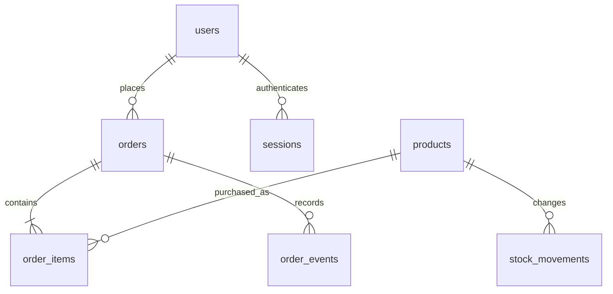

# Sako Supply

A full-stack, single-store rice wholesale research prototype: responsive HTML/CSS/JavaScript frontend, Node.js backend, and a persistent SQLite SQL database. Every active product is a **25 kg sack**. Customers can buy multiple sacks; no minimum count is imposed.

## Open on a Windows laptop

1. Install **Node.js 24 LTS** from https://nodejs.org.
2. Download this repository using **Code → Download ZIP** and extract it.
3. Open the extracted folder containing `package.json`.
4. Click the File Explorer address bar, type `cmd`, and press Enter.
5. Run these commands, one at a time:

```sh
npm install
npm start
```

6. Keep the command window open and visit **http://localhost:3000** in Chrome or Edge.

To stop the server, press Ctrl+C in that command window. To start again, run `npm start`. If port 3000 is busy, stop the older server first or run `set PORT=3001` in Windows Command Prompt before `npm start` and browse to port 3001.

**Updating a previous download:** stop the old server and back up the existing `data` folder. Extract the new ZIP to a separate folder, copy your `data` folder into it, then run `npm install` and `npm start`. Do not overwrite an existing database with an empty one. Old 5 kg listings are archived, while existing orders are preserved.

## Customer capabilities

- Register, sign in, sign out, and update name, phone, and default address.
- Browse/search/filter/sort 25 kg rice products and read product details, texture, and cooking notes.
- Add multiple sacks, set quantities, choose pickup or delivery, and place an order.
- View only your own order history, status timeline, receipts, and shared driver GPS on a street map.
- Print a receipt or choose **Save as PDF** from the browser print window.

Use fictional contact information for the defense. Customer passwords are salted and hashed with scrypt. Customer and admin sessions are stored in the database, expire after 24 hours, and are revoked on logout.

## Admin dashboard

Click the regular **Sign in** button. Admin and customer accounts use the same email/password form. Demo admin email: **`admin@sakosupply.com`**; password: **`admin123`**. Successful admin sign-in opens the dashboard and reveals its navigation link. Customer accounts never see admin controls. `ADMIN_EMAIL` and `ADMIN_PASSWORD` can override these demo defaults. `/admin` remains an optional shortcut to the same sign-in form; it is no longer necessary. Use an incognito window or another browser for simultaneous customer/admin demonstrations.

- **Overview:** pending orders, low stock (10 or fewer sacks), available sacks, recent active orders, and today's completed order totals.
- **Orders:** search by reference/name/phone, filter status, view details, print receipts, record cash collection, and progress orders.
- **Products & inventory:** create/edit/archive products, upload product photos, and record positive or negative stock adjustments with reasons. New products start at zero stock. Use **Change image** in the inventory table to preview, replace, or remove a photo. You can also upload a photo while creating a product. Only supplier-authorized PNG/JPEG/WebP images under 2 MB are accepted.
- **Customers:** search registered customers and view their order histories.
- **Reports:** date-filtered completed sales, rice revenue excluding delivery, best sellers, and downloadable CSV.

Order flow:

- Delivery: Pending → Preparing → Out for delivery → Completed.
- Pickup: Pending → Preparing → Ready for pickup → Completed.
- Active orders can be cancelled. Stock is restored exactly once.

Payment and order status are independent. Reports use order-placement dates in Philippine time and currently completed orders. They include demo electronic payments and can include unpaid completed cash orders; a separate ledger reports admin-recorded cash by collection date. Neither report is a tax or profit report.

## Payment simulations — no real money

Cash, card, GCash, and Maya appear at checkout. **All electronic payments are simulations.** No merchant accounts, payment gateways, wallet credentials, or real card processing are connected.

Card fields are present for demonstration only. Use:

| Test                  | Card number           | Future expiry | Test CVC |
| --------------------- | --------------------- | ------------- | -------- |
| Successful simulation | `4242 4242 4242 4242` | `12/30`       | `123`    |
| Declined simulation   | `4000 0000 0000 0002` | `12/30`       | `123`    |

Never enter a real card. Card number, expiry, and CVC remain in browser-only fields and are not included in API requests or stored in the database. The backend rejects known raw-card fields. GCash and Maya show a selectable successful/declined demo outcome; no QR transfer or wallet login is requested.

Failed demo payments create no order and reserve no stock. Successful simulations show **Demo paid**; cancellation changes that to **Demo refunded**, without moving funds. Cash orders remain **Unpaid** until an admin records collection. Printed documents are clearly labeled research-demo order acknowledgments/receipts, **not tax invoices or official receipts**.

## Delivery zones, bulk pricing, and the map

Every active listing is a 25 kg sack. Sample wholesale discounts are calculated on the server in integer centavos: **10–24 sacks: ₱25 off each; 25+ sacks: ₱50 off each**. Different rice types can be combined. Prices never fall below ₱1 per sack. Checkout and printed receipts show savings separately.

Sample delivery zones: **Koronadal ₱150, Tupi ₱300, Tantangan ₱250**. Pickup is free. These are demonstration rates, not verified carrier quotes or a promise of service coverage.

The Leaflet map loads real OpenStreetMap street tiles, with optional MapTiler configuration. It displays the assigned driver's latest device location only after the driver explicitly starts sharing while Out for delivery. No truck movement, progress percentage, destination coordinates or route is generated. Missing and stale locations are labelled. Pickup orders have no map. See [live tracking setup](docs/LIVE-TRACKING.md) for driver links, HTTPS, privacy and provider limits.

## Products and market descriptions

The catalog includes Dinorado, Jasmine, Sinandomeng, well-milled white rice, and brown rice—rice retail names/types familiar in the Philippine market. They are **not all cultivars or commercial brands**. The illustrations are fictional Sako packaging. Do not interpret them as supplier-certified brands, Philippine-grown origin claims, current retailer stock, or verified commercial 25 kg offerings. Sample pricing and quantities are for research only. Verify the actual supplier's specifications, origin, price, packaging, availability, and image permissions before commercial use.

## Database and architecture

No XAMPP or separate database server is required. SQLite creates `data/sako.sqlite` on first startup. It is a SQL relational database, **not MySQL**, and is not managed through phpMyAdmin. Database setup lives in [db/schema.sql](db/schema.sql); backwards-compatible migrations are in `db.js`.

Tables include `users`, `products`, `orders`, `order_items`, `sessions`, `stock_movements`, `order_events`, `collections`, `admin_log`, and `notifications`. Monetary calculation and new snapshots use integer centavos; legacy peso fields remain for API/receipt compatibility. Orders retain immutable product/price snapshots so catalog changes do not rewrite receipts. The old order JSON snapshot is retained solely for compatibility; the application uses normalized `order_items`.



Backend responsibilities: access control, server-calculated prices/fees, atomic stock reservation, order transitions, receipt data, and SQL persistence. Frontend responsibilities: interface, client-only test card form, print layout, and the demo map.

Back up the complete `data` directory (database plus uploaded photos) while the server is stopped. Do not delete data to reset a demonstration without preserving existing orders. `DATA_DIR` can point to another database directory; `PORT` changes the server port.

## Validation

```sh
npm test
```

Integration tests use isolated temporary databases and verify customer authentication/ownership, order pricing, stock, simulated payment success/failure, cancellation, status transitions, reports, images, migration, restart persistence, and logout.

Optional browser tests:

```sh
npx playwright install chromium
npm run test:browser
```

If you already have a Chromium installation, set `SAKO_CHROMIUM` to its executable path instead. Browser tests verify customer checkout, browser-only card fields, printable PDF layout, map movement, admin management/report export, and mobile layout. Test-only records never enter your regular database.

## Suggested defense flow

1. Explain the problem: bulk rice orders, manual stock checking, and order follow-up.
2. Show the 25 kg catalog and product details. Add five sacks.
3. Register a fictional customer; select delivery and simulate a card or wallet payment.
4. Show the order reference, payment status, and printable receipt.
5. In a second/incognito browser, click **Sign in** and use the demo admin email/password, prepare the order, then dispatch it.
6. Keep the customer's order details open; the status updates automatically. Issue a driver link and share device GPS to show actual submitted location updates.
7. Complete the order and show its report entry; export a CSV.
8. Create a second order, cancel it, and show stock restoration and the inventory audit log.

Use the explanation and scope notes in [docs/DEFENSE.md](docs/DEFENSE.md). Do not present simulated payments as real financial integrations or invented product descriptions as verified supplier data.

## Before commercial deployment

This is a defense prototype. Real payments require a provider's hosted payment fields/checkout and server-verified webhooks; device tracking requires the assigned driver’s explicit consent, HTTPS and a reachable server; address geocoding and road routing remain unimplemented. Also configure HTTPS, a strong admin password, backups, privacy/retention rules, email verification and account recovery, production monitoring, and secure payment/refund policies. No real payment should depend on a browser-supplied success flag.

## Visual refresh and tracking changes

The interface now uses mint backgrounds, rounded white cards, pill controls, and a bundled rice-field illustration inspired by an agriculture dashboard. It remains responsive on phones. All illustrations load locally; fonts and the bundled video do not require third-party website access. Street map tiles require an external provider. System fonts are used.

Existing pickup orders remain pickup orders; they are never silently converted to deliveries. To demonstrate delivery tracking, place a **new delivery order**, open **Open delivery map**, and use a second/incognito admin window to progress Pending → Preparing → Out for delivery. The admin issues a private driver link from order details. The driver must open it, consent and start sharing on an HTTPS site before a location marker appears. Browser/device location accuracy and foreground limitations apply.

Screenshots of the refreshed interface: [desktop storefront](docs/screenshots/storefront.png) · [mobile storefront](docs/screenshots/mobile.png).

## Light and dark mode

Use the theme toggle beside the bag button. The first visit follows your device's light/dark preference; a manual choice is saved in this browser and survives reloads. The theme applies to the storefront, account forms, and dashboard. Product photos retain their original colors, and printed receipts keep a white background.

## Product image collection

The five standard rice types include bundled, AI-generated Sako 25 kg packaging mockups with coordinated pale sage studio backgrounds and distinct rice labels. They are illustrative house-brand designs, not verified photographs of commercial supplier packaging. Images load locally from `public/assets/products`, without third-party image links. Uploaded admin photos take precedence; removing a custom photo restores the matching default for standard products. Product cards open details; click **View larger** in the product details image for an enlarged, keyboard-accessible viewer (Escape closes it).

## Defense rubric and implementation status

See [docs/RUBRIC-CHECKLIST.md](docs/RUBRIC-CHECKLIST.md) for the exact four criteria from the supplied IT 201 format, the evidence available, and remaining limitations. [docs/IMPLEMENTATION-STATUS.md](docs/IMPLEMENTATION-STATUS.md) maps the requested hardening/features to their current state. A rubric checklist is not a promised grade or a completed user-acceptance study.

## Additional customer/admin tools

- **Reorder** adds an old order's quantities to the current bag, using current stock and pricing. It refuses unavailable items instead of silently substituting them.
- Customers can **cancel Pending orders**; stock is restored once. Orders already being prepared require admin handling.
- **Updates** is an authenticated in-app demonstration notification log; no SMS/email is sent.
- **Stock alert** lets an admin set each product's reorder point.
- Overview includes real-data **daily and weekly completed-sales charts**, with accessible data tables and no fabricated sales.
- Reports include a separate **cash collection ledger**, filtered by collection date. Electronic demo payments and historical “Paid” entries without a collection record are excluded. The ledger records what an admin enters; it is not independent proof of payment.
- **Admin audit** records successful admin mutations with actor email, action/target, and timestamp. The application still has one configured admin identity; cashier/staff roles are not implemented.

## Security and maintenance

Scripts are restricted by CSP to local files. Inline styles remain allowed for Leaflet and chart/layout styles. Customer names, addresses, product text, and audit entries are escaped before HTML rendering; browser tests include stored-markup probes. Image uploads are size-limited, byte-counted, and signature-checked; SVG uploads are not accepted.

Only failed logins count toward the 8-per-10-minute IP+email bucket; an additional failed-attempt IP cap protects against email rotation. Successful login clears the account bucket. Registration has a separate creation limit; order submissions have a per-customer 20-per-minute limit. Limits are in process memory, so a multi-instance production deployment needs shared limiting. Responses include Retry-After when throttled.

Expired sessions are removed on startup and every 15 minutes. Existing admin123 is deliberately retained for your defense, with a startup warning; set ADMIN_PASSWORD for any public deployment. Logs contain method, path, status, and time, not passwords or request bodies. `GET /health` checks the SQL connection.

Money snapshots, expiry cleanup, indexes, and stock validation are additive migrations. Historical order JSON is retained because earlier local versions may still need it; normalized order_items remains authoritative. Legacy products receive SQL validation triggers, and fresh products also have base NOT NULL/CHECK constraints. Existing receipts are preserved.

## Backups and deployment files

```sh
npm run backup
```

Backups use SQLite's online backup API plus a copy of uploaded images, in an ignored `backups/` folder. A restore-integrity test is included. For the most consistent full-folder backup, stop writes while backing up uploaded files. Automatic backups run at **02:00 Philippine time while the server is running**; missed schedules are not replayed. `AUTO_BACKUP=off` disables scheduling; `BACKUP_DIR` changes the destination. Backups are not automatically deleted; monitor storage and keep an off-device copy. Treat backups as private customer data.

An optional `.env.example` is provided. Normal `npm start` uses the environment already set; `.env` is only loaded with `npm run start:env` after you copy/edit the example. Never commit real credentials.

A non-root Node 24 Dockerfile and a GitHub Actions workflow running npm test are included. CI status must be checked on GitHub; local passing tests do not establish a remote CI run. Persist `/app/data` and `/app/backups` with volumes when using Docker.

## Phone installation and offline behavior

A manifest, app icons, and a service worker provide a basic installable app shell on supported HTTPS/localhost browsers. The cache is network-first and stores only public static shell files. It **never caches API responses, customer records, or order mutations**. Offline sign-in, checkout, and tracking are unsupported and an offline banner explains the limitation. Browser installation prompts depend on the browser/device. The bundled tutorial video has controls, captions, and a written transcript.

### Policy pages and customer password recovery

The footer and sign-in dialog link to `/privacy.html` and `/agreement.html`. These notices describe the research prototype and require review before real deployment. The registration interface requires an agreement checkbox; it is not a versioned legal-consent audit system.

Customer recovery is admin-assisted by default; optional Resend delivery enables verified-email recovery (see configuration below). A customer selects **Forgot password?** and contacts the project administrator through the existing school/demo contact channel. After independently verifying identity (do not rely solely on knowing an email address), the admin opens **Customers → Issue recovery code**, confirms verification and privately provides the displayed code. Codes expire in 15 minutes, are stored hashed, and are single-use; issuing another invalidates the previous code. The customer submits their email, code and new password. Successful recovery revokes all their sessions. Public reset attempts are rate-limited; issuing a code requires an admin session and is audited. No code is returned by a public email-lookup endpoint. Admin credentials remain configured through `ADMIN_PASSWORD`, not this customer recovery flow. Never publish or screenshot real recovery codes. A verified sender/email service is still required for self-service emailed links.


### Contact/help, returns policy and optional account emails

`/help.html` provides FAQs and the configured support email; `/returns.html` explains cancellation and the prototype's lack of actual financial refunds. Set `SUPPORT_EMAIL` to a real monitored address if desired. No public message-submission form or support inbox is implied.

To connect account emails:
1. Create a Resend account and verify your own sender/domain there.
2. Copy `.env.example` to `.env` and set `EMAIL_API_KEY`, `EMAIL_FROM`, and `PUBLIC_URL` (the exact root origin of your deployed HTTPS site). For local testing only, `http://localhost:3000` is accepted; email links then open that local machine.
3. Set `SUPPORT_EMAIL` if you have a monitored contact address. Keep `.env` private.
4. Start with `npm run start:env`. Sign in as a customer, open Your account and select Send verification email. Open the received link or paste its code to verify ownership.
5. Sign out, use Forgot password → Email recovery link, then open the received link and set a new password. Check your real inbox/spam folder and the provider dashboard before claiming live delivery works.

Existing accounts remain unverified. Email verification is optional for shopping but required for emailed recovery; users unable to verify use administrator-assisted recovery. Both verification and reset tokens are random, stored as SHA-256 hashes, single-use and expire after 15 minutes. They are submitted with POST; links keep codes in the URL fragment, which the frontend clears before showing the form. Requesting a new code replaces the previous code. Reset revokes existing customer sessions. Mail requests have per-IP and per-account limits. Public recovery responses do not disclose whether an account exists, is verified, or the provider rejected the message. No tokens or provider credentials are returned publicly or logged. A mail failure removes the pending token; an authenticated verification requester sees a send error. Account emails use Resend's HTTPS API and a 10-second timeout; no browser API key or new runtime package is needed. Order status emails/SMS remain unimplemented. Admin passwords continue to use server environment configuration.

If any required email setting is absent or PUBLIC_URL is invalid, email controls show that delivery is disconnected and assisted recovery stays available. Automated tests use a local fake mail provider, not a real inbox; external delivery requires your credentials and sender verification. The test-only EMAIL_API_URL override is not needed in production.


### Password controls and final checkout review

Sign-in, registration and password reset have accessible Show/Hide controls. Registration and reset require matching confirmation fields; the repeat password is checked in the browser and is not transmitted or stored. Password length and hashing remain enforced by the backend.

Checkout now uses **Review order → Confirm and place order**. The review shows rice products, sack quantities, base prices, customer contact details, pickup or delivery address/zone, payment method, subtotal, bulk discount, delivery fee and total. **Back to edit**, closing the review, or Escape returns to the existing checkout without submitting. Raw card fields are not copied into the review or request. Inventory is reserved only after confirmation succeeds; the backend still validates stock and calculates the authoritative price.

### Hosting: Vercel versus a persistent Node server

This app's local SQLite database and uploaded photos need persistent storage; Vercel functions are not suitable without a database/storage migration. See [deployment instructions](docs/DEPLOYMENT.md) for the runtime error explanation, local presentation option, and the included `render.yaml` for a **paid**, single-instance Render service with a persistent disk. No hosted deployment has been created by adding the configuration.

### Wallet preview, agreement summary and back-to-top

GCash and Maya use a clearly labelled, Sako-hosted demo authorization screen after order review. Customers see merchant, amount, payment steps and a temporary preview-session label; they can approve, cancel, or choose a declined demonstration scenario. No wallet login, MPIN, OTP, scannable payment QR, external app redirect or real charge is used. The five-minute preview expires locally. Cancel/close/Escape/expiry retain the cart and do not submit an order; failed payment submits the simulated failure to the backend and creates no order. Successful demo authorization submits the order for server stock/pricing validation; the actual order reference is assigned only after success. The preview identifier is not a provider transaction reference. Electronic payments still trust an explicitly simulated outcome and must not be used commercially. Real payments require merchant onboarding, provider-hosted authorization and signature-verified server webhooks.

Registration includes a plain-language agreement summary and links before the required acceptance checkbox; the full agreement expands responsibilities, data use, payment limits, cancellation and user choices. Back-to-top controls appear after scrolling on the storefront, long dialogs and public help/policy pages, support keyboards and reduced-motion preferences, and are hidden for printing.

### Wholesale minimum, delivery slots, reservations, acknowledgment and feedback

**Admin → Store settings** controls minimum sacks (1–1000; initial value **1** to preserve the previous ordering behavior), unpaid Pending reservation minutes (5–1440; initial **30**), and maximum orders per delivery window (1–100; initial **5**). Changes apply to new orders; old reservations retain their deadlines. Mixed products count together. Reducing capacity does not cancel existing bookings.

Delivery checkout offers the next **14 days, starting tomorrow**, in **09:00–12:00** and **13:00–17:00 Philippine time** windows. The first available choice is selected and shown in review, order details and the receipt; customers may change it before confirming. Capacity is counted in orders, not truck weight or route distance. The server validates capacity inside the same transaction as stock reservation. Cancelled/expired orders release their slot. Older API clients omitting a schedule receive the next available slot; historical rows without one remain unchanged. There is no holiday calendar, arrival-time guarantee, automatic route planning or rescheduling UI.

New **Unpaid + Pending** orders receive a reservation deadline. A countdown appears in details. Every 30 seconds while running, on startup, and before API requests, the server cancels expired qualifying orders, restores stock once, records a movement/event and notifies the customer. Preparing/Out for delivery/Completed/Paid orders do not qualify: cash on delivery is not cancelled while in progress. Old orders without deadlines are not retroactively expired. If the server is stopped, expiry is reconciled when it restarts. Server time/status is authoritative; a browser countdown is informational. Test electronic payments remain simulations.

**Delivery acknowledgment:** the customer can optionally consent at checkout to a receiver first name and notes (no photo/signature). The assigned driver’s private page offers an acknowledgment form only during Out for delivery with that consent; the driver must affirm the receiver agreed and received the sacks. One report per order is retained with a timestamp. It is a driver report, not independently verified proof or an identity check. The customer can separately confirm receipt in order details. Reporting does not automatically complete an order or record payment; the admin still manages completion/collection. No-consent orders continue without this optional report.

Completed-order details include an editable 1–5 rating/comment form (1000-character limit). Only the order owner can submit it. Feedback is private to that customer and administrators; **Admin → Customer feedback** lists recent entries. It is not a public product-review system. Order ownership, completed status, input bounds and text escaping are enforced; customer data/proofs/feedback must not be committed to GitHub. Backups may retain copies; follow the privacy notice and retention rules.
