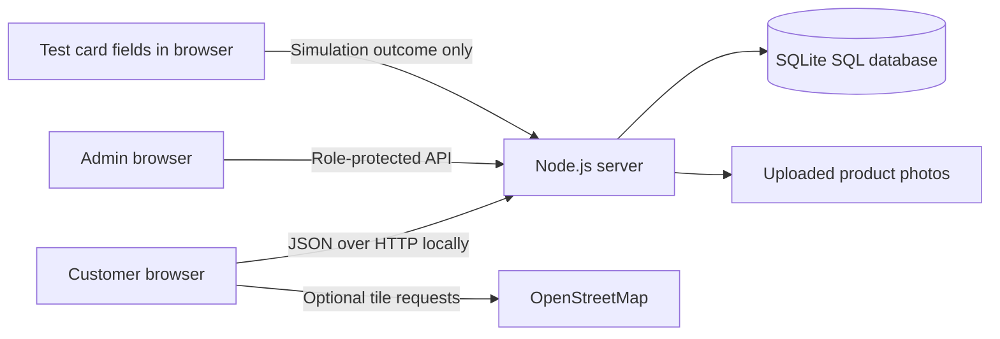

# Research defense guide

Suggested title: **Sako Supply: A Web-Based Wholesale Rice Ordering and Inventory Management System**.

## Scope

An individual project for a single bigasan selling 25 kg sacks. Two roles: customer and administrator. The prototype supports bulk quantities, SQL inventory, account-specific order history, printable order receipts, and administrative reports. Electronic payments and delivery movement are deliberately simulated for demonstration.

## Objectives and evidence

| Objective                              | Feature                                                           | Demonstration                                                |
| -------------------------------------- | ----------------------------------------------------------------- | ------------------------------------------------------------ |
| Provide online wholesale rice ordering | Product details, 25 kg catalog, cart, authenticated checkout      | Place an order for multiple sacks                            |
| Maintain stock availability            | Server-side stock checks and SQL transactions                     | Order reduces available stock; cancellation restores it once |
| Help customers follow orders           | Personal order history, timeline, sample delivery map             | Admin dispatches; customer views simulation                  |
| Maintain transaction documentation     | Order-item snapshots and printable receipts                       | Print / Save as PDF, with payment status visible             |
| Support store monitoring               | Admin dashboard, product management, customer list, sales reports | Adjust inventory with a reason and export completed sales    |

## Architecture

A deployed version requires HTTPS. The prototype's browser card fields never send number/CVC/expiry to the application server. Simulated coordinates are generated by the server from dispatch time; they are not rider GPS.

## Questions you may be asked

**Why SQLite?** It is a relational SQL database and keeps this individual prototype portable without a separate MySQL service. A MySQL migration would require a different driver, SQL adjustments, and a database server; it has not been implemented.

**How do you prevent overselling?** The server validates all line items and reserves stock inside one SQL transaction. The browser does not decide the price, delivery fee, stock availability, or order ownership.

**What happens when an order is cancelled?** The order can only transition from an active state. Its stock is restored once, and a status event and stock movements are recorded. A successful simulated electronic payment becomes Demo refunded. Real refunds are outside scope.

**Is this a payment gateway?** No. Card, GCash, and Maya screens demonstrate successful/failed checkout outcomes. No funds move, no wallet account is accessed, and no real card details should be entered.

**Where is the admin login?** Open `/admin` directly. Guests see a sign-in form, not protected dashboard data. The Dashboard navigation entry appears only after successful admin authentication; customer accounts cannot access the admin API.

**Why might an order have no map?** Store pickup has no delivery journey. Checkout requires a deliberate pickup/delivery choice. Delivery orders show the map immediately, and the demo truck starts after admin dispatch. Both order types poll status automatically.

**Is the map live GPS?** No. It is an updating simulation of a fixed Koronadal route, clearly labeled in the interface. Real GPS and customer-address routing require additional services and driver participation.

**Are these official receipts?** No. They are printable research-demo order records with itemized totals and payment status, not BIR official receipts or tax invoices.

**Are all product names brands?** No. The catalog uses Philippine-market rice retail names, grain types, and milling descriptions. Commercial supplier brands, current stock, pricing, country of origin, and exact 25 kg packaging must be verified before actual selling.

**What is counted as sales?** Reports include completed orders filtered by order-placement date in Philippine time, including delivery fees. They label demo electronic payments and may include unpaid cash orders; they are not collected-cash or profit reports.

## Research integrity

Use actual interviews, observations, or surveys for the problem statement. Do not invent respondents, test participants, acceptance scores, or research results. Automated technical tests establish software behavior, not completed user acceptance testing or an ISO 25010 evaluation.
