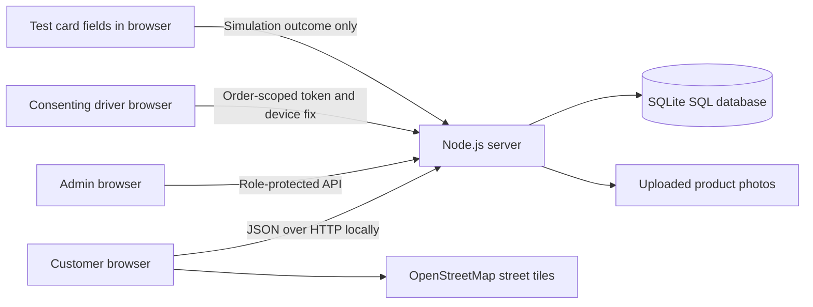

# Research defense guide

Suggested title: **Sako Supply: A Web-Based Wholesale Rice Ordering and Inventory Management System**.

## Scope

An individual project for a single bigasan selling 25 kg sacks. Customer and administrator accounts, plus order-scoped driver access links. The prototype supports bulk quantities, SQL inventory, account-specific order history, printable order receipts, and administrative reports. Electronic payments remain simulated. Delivery locations come from an assigned driver’s consenting device.

## Objectives and evidence

| Objective                              | Feature                                                           | Demonstration                                                |
| -------------------------------------- | ----------------------------------------------------------------- | ------------------------------------------------------------ |
| Provide online wholesale rice ordering | Product details, 25 kg catalog, cart, authenticated checkout      | Place an order for multiple sacks                            |
| Maintain stock availability            | Server-side stock checks and SQL transactions                     | Order reduces available stock; cancellation restores it once |
| Help customers follow orders           | Personal order history, timeline, street map with driver device location             | Admin dispatches; driver shares GPS; customer views latest fix                  |
| Maintain transaction documentation     | Order-item snapshots and printable receipts                       | Print / Save as PDF, with payment status visible             |
| Support store monitoring               | Admin dashboard, product management, customer list, sales reports | Adjust inventory with a reason and export completed sales    |

## Architecture

A deployed version requires HTTPS. The prototype's browser card fields never send number/CVC/expiry to the application server. Coordinates are submitted by the assigned driver’s browser after explicit consent. They are not generated by dispatch time; device accuracy, permissions and network access affect availability.

## Questions you may be asked

**Why SQLite?** It is a relational SQL database and keeps this individual prototype portable without a separate MySQL service. A MySQL migration would require a different driver, SQL adjustments, and a database server; it has not been implemented.

**How do you prevent overselling?** The server validates all line items and reserves stock inside one SQL transaction. The browser does not decide the price, delivery fee, stock availability, or order ownership.

**What happens when an order is cancelled?** The order can only transition from an active state. Its stock is restored once, and a status event and stock movements are recorded. A successful simulated electronic payment becomes Demo refunded. Real refunds are outside scope.

**Is this a payment gateway?** No. Card, GCash, and Maya screens demonstrate successful/failed checkout outcomes. No funds move, no wallet account is accessed, and no real card details should be entered.

**Where is the admin login?** Use the regular Sign in form with admin@sakosupply.com and the local demo password admin123. The server assigns the admin role after verifying both credentials. The Dashboard navigation entry appears only after successful admin authentication; customer accounts cannot access the admin API.

**Why might an order have no map?** Store pickup has no delivery journey. Checkout requires a deliberate pickup/delivery choice. Delivery orders show the map immediately, and the demo truck starts after admin dispatch. Both order types poll status automatically.

**Is the map live GPS?** It displays the latest device location submitted by an assigned, consenting driver. Without driver sharing there is no marker. Browser tests use mocked geolocation and tiles; real phone GPS/provider availability must be verified on the deployed HTTPS site. No address geocoding, ETA or road routing is claimed.

**Are these official receipts?** No. They are printable research-demo order records with itemized totals and payment status, not BIR official receipts or tax invoices.

**Are all product names brands?** No. The catalog uses Philippine-market rice retail names, grain types, and milling descriptions. Commercial supplier brands, current stock, pricing, country of origin, and exact 25 kg packaging must be verified before actual selling.

**What is counted as sales?** Reports include completed orders filtered by order-placement date in Philippine time, including delivery fees. They label demo electronic payments and may include unpaid cash orders; a separate ledger reports admin-recorded cash by collection date. Neither report is a profit report.

## Research integrity

Use actual interviews, observations, or surveys for the problem statement. Do not invent respondents, test participants, acceptance scores, or research results. Automated technical tests establish software behavior, not completed user acceptance testing or an ISO 25010 evaluation.

## Updated technical talking points

- Street tiles come from OpenStreetMap with a suitable referrer policy, or configured MapTiler. Provider errors are shown honestly; no illustrated fallback or invented movement is used. See LIVE-TRACKING.md.
- Wholesale tiers apply across rice types. At 10 sacks, a ₱1,450 sack becomes ₱1,425. Ten sacks delivered to Tupi total **₱14,550** (₱14,250 rice + ₱300 sample zone fee).
- Integer-centavo calculations prevent fractional-peso rounding drift in pricing. Existing peso fields are maintained for older receipts/API compatibility.
- Overselling is tested across two server processes sharing SQLite: two attempts for the last sack produce one order and one stock rejection.
- Completed-order revenue and collected cash are different reports. Explain the dates, payment flags, and demo-payment limitations.
- The CSP prohibits inline scripts and third-party script sources. Inline styles are retained for Leaflet; escaping and upload validation remain necessary.
- Admin changes have an audit trail for the configured admin email. This does not mean cashier/staff roles exist.
- The tutorial is a locally bundled, silent 15-second walkthrough with captions and a written transcript.

Use [RUBRIC-CHECKLIST.md](RUBRIC-CHECKLIST.md) as your demonstration checklist and [IMPLEMENTATION-STATUS.md](IMPLEMENTATION-STATUS.md) for scope boundaries.
